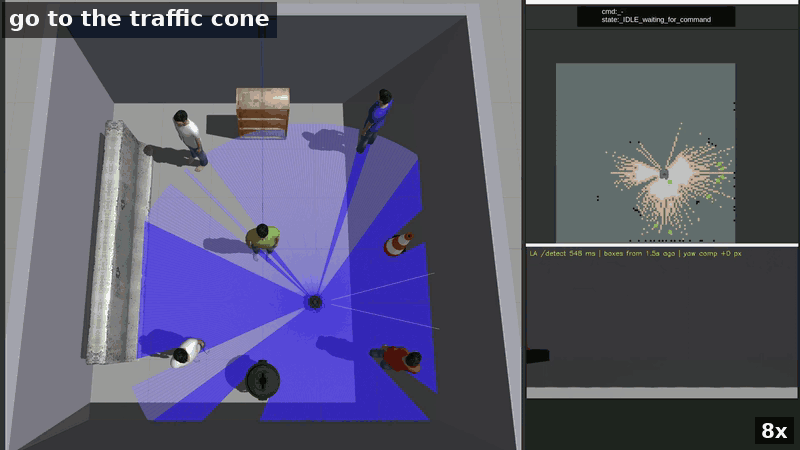
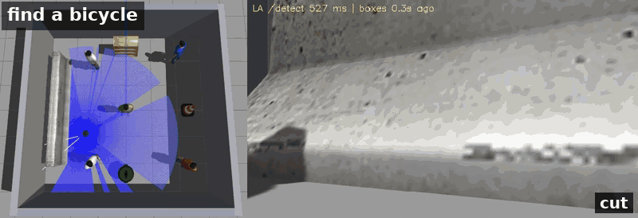

# Open-Vocabulary Semantic Navigation on TurtleBot3

Put a TurtleBot3 in a room it has never seen and tell it `go to the traffic cone`.
It explores while looking for the object with NVIDIA LocateAnything-3B, and once
it has confirmed the object on its map it drives there and stops in front of it.
If the object is not in the room, it reports `TARGET NOT FOUND`.



[Full demo (MP4)](https://drive.google.com/file/d/18F5ohdnKwmt9mzpMIQ4fdjLsyu8toZMJ/view?usp=sharing)
· Gazebo simulation · ROS 2 Humble · Nav2 · SLAM Toolbox

## How it works


- **Command first.** The robot stands still until a command arrives. If the
  object is already a landmark on the map, it drives there directly; otherwise
  the phrase is added to the detector vocabulary and frontier exploration
  starts, as the search for that object.
- **One perception model.** Each new camera view goes to LocateAnything-3B
  (served over HTTP from a GPU container), which returns labelled 2D boxes for
  every phrase in the vocabulary. A box's bearing plus the LiDAR range gives
  the object's position.
- **Landmarks need repeated evidence.** A detection becomes a map landmark only
  after at least 3 distinct detections at the same place, which keeps one-off
  false boxes off the map.
- **Explicit negative answer.** When there are no frontiers left and a short
  patrol of the room finds nothing, the robot reports `TARGET NOT FOUND` and
  holds its position.



## LocateAnything-3B vs. YOLOv8n

The [`yolov8n-baseline`](https://github.com/YiyuchenHu/TurtleBot3-semantic-navigation/tree/yolov8n-baseline)
branch runs the same stack with YOLOv8n.

| | YOLOv8n (baseline) | LocateAnything-3B (this branch) |
|---|---|---|
| Vocabulary | 80 fixed COCO classes | free text |
| Attributes / relations | no | yes, e.g. "the person wearing a green shirt" |
| Absent target | an unfamiliar object is reported as the nearest known class | usually no box; close-up false boxes still occur and are filtered by the landmark gates |
| Latency per frame | ~10 ms (CPU) | ~0.5 s (GPU, RTX 5090) |
| Weights | 3M parameters | 3B parameters ([NVIDIA licence, non-commercial research](https://huggingface.co/nvidia/LocateAnything-3B)) |

## Quick start (Docker)

**Requirements**

- Linux host with an X11 desktop session (Gazebo and RViz open as windows on it)
- NVIDIA GPU with at least 14 GB of memory (measured on an RTX 5090: about 10 GB for the grounding server, 13 GB for the whole GPU with Gazebo, RViz and the desktop)
- NVIDIA driver 570 or newer, and the [NVIDIA Container Toolkit](https://docs.nvidia.com/datacenter/cloud-native/container-toolkit/latest/install-guide.html)
- Docker with the Compose plugin; about 30 GB of free disk space

Run every command from the repository root.

**1. Clone and build the images** (about 6 GB of downloads, 13 GB on disk)

```bash
git clone https://github.com/YiyuchenHu/TurtleBot3-semantic-navigation.git
cd TurtleBot3-semantic-navigation
docker compose -f docker/compose.yaml -f docker/compose.local.yaml build
```

**2. Start the containers.** On the first start the grounding container
downloads the LocateAnything-3B weights (about 7.7 GB) into a Docker volume;
later starts reuse them.

```bash
xhost +local:docker
docker compose -f docker/compose.yaml -f docker/compose.local.yaml up -d
curl -s http://127.0.0.1:8801/health    # repeat until it answers with JSON
```

`curl` gets no answer while the weights download and load; follow progress with
`docker compose -f docker/compose.yaml -f docker/compose.local.yaml logs -f grounding`.

**3. Build the ROS 2 workspace** inside the sim container. This also generates
the coloured-shirt person models the default world uses.

```bash
docker compose -f docker/compose.yaml -f docker/compose.local.yaml exec sim ./build.sh
```

**4. Launch the stack** (Gazebo, SLAM Toolbox, Nav2, perception, exploration,
coordinator and RViz):

```bash
docker compose -f docker/compose.yaml -f docker/compose.local.yaml exec sim bash
ros2 launch tb3_coordinator full_semantic_nav_la.launch.py
```

Give it about 30 s. The robot then waits in place for a command.

**5. Send commands** from a second terminal. The status topic first shows
`[IDLE] started in IDLE mode — standing still, waiting for /user_command`.

```bash
docker compose -f docker/compose.yaml -f docker/compose.local.yaml exec sim bash
ros2 topic pub -1 -w 1 --keep-alive 2 /user_command std_msgs/msg/String "{data: 'go to the traffic cone'}"
ros2 topic echo /coordinator_node/status
```

The status goes through `[SEARCHING]` and `[SEMANTIC_NAV]` to
`[TARGET_REACHED] Nav2 goal succeeded — target reached` and then
`[IDLE] holding position after TARGET_REACHED — send a new command`
(one to a few minutes, as the robot has to find the cone first). Wait for the
`[IDLE]` line, stop `echo` with Ctrl-C, and send the next command, for example:

```bash
ros2 topic pub -1 -w 1 --keep-alive 2 /user_command std_msgs/msg/String "{data: 'find a bicycle'}"
```

There is no bicycle in the room, so this one ends in
`[TARGET_FAILED] TARGET NOT FOUND: 'bicycle' — exploration complete, nothing promoted`
and then `[IDLE] holding position after TARGET_FAILED — send a new command`.
It takes longer, often 5–15 minutes: the robot first explores the whole room
and then patrols four waypoints before it gives up.

`--keep-alive 2` keeps the publisher up long enough for the single message to
be delivered; without it a command is occasionally lost. Send each command
once: a second copy counts as a new command. A command needs a verb (`go to`, `find`, `navigate to`, ...) followed by the
object. Stop everything with
`docker compose -f docker/compose.yaml -f docker/compose.local.yaml down`
(the weights and the build stay in their volumes).

## Branches

| Branch | What it is |
|---|---|
| `main` | This version: LocateAnything-3B, command-first open-vocabulary search, Docker on an NVIDIA GPU. |
| [`yolov8n-baseline`](https://github.com/YiyuchenHu/TurtleBot3-semantic-navigation/tree/yolov8n-baseline) | The original 2026-04 version with YOLOv8n: explore and map first, then query by class name. |
| [`yolo26n-finetuned`](https://github.com/YiyuchenHu/TurtleBot3-semantic-navigation/tree/yolo26n-finetuned) | A YOLO26n detector fine-tuned on simulator data for 3 classes; runs on a CPU on Ubuntu, macOS (Docker) and Windows (WSL 2). |

## Known limitations

- Validated only in simulation (Gazebo Classic, one 6 × 6 m test room).
- Cross-view object identity is the main open problem: landmark memory counts
  detections per frame, not per physical object, so one object seen from
  different viewpoints can split into two landmarks, and two nearby objects can
  merge into one.
- One LocateAnything-3B call takes about 0.5 s, so the robot sees only a few
  frames per second while it explores.
- Sensors are a single monocular RGB camera and a 2D LiDAR; there is no depth
  camera, so an object's position comes from the LiDAR range along the box
  bearing.

## License and acknowledgements

The code in this repository is released under the [MIT License](LICENSE).

The LocateAnything-3B weights are distributed by NVIDIA under the NVIDIA
License for non-commercial research use only. They are not included in this
repository; the grounding container downloads them from
[Hugging Face](https://huggingface.co/nvidia/LocateAnything-3B) on first start.

The HTTP grounding server in `grounding/` started from [Advaith Dasu's fork](https://github.com/advaithdasu/TurtleBot3-semantic-navigation) of this repository; it was fixed and extended here to run LocateAnything-3B end to end.

Built on [ROS 2](https://docs.ros.org/en/humble/), [TurtleBot3](https://github.com/ROBOTIS-GIT/turtlebot3_simulations),
[Nav2](https://github.com/ros-navigation/navigation2),
[SLAM Toolbox](https://github.com/SteveMacenski/slam_toolbox) and
[Gazebo Classic](https://classic.gazebosim.org/). The YOLOv8n baseline uses
[Ultralytics](https://github.com/ultralytics/ultralytics) (AGPL-3.0). The
Gazebo models in the test world come from
[osrf/gazebo_models](https://github.com/osrf/gazebo_models) and are downloaded
when the image is built, not redistributed here: `person_standing` (Marina
Kollmitz), `bookshelf`, `first_2015_trash_can`, `ground_plane` and `sun`
(Nate Koenig), `construction_cone` and `jersey_barrier` (Cole Biesemeyer and
Nate Koenig).
