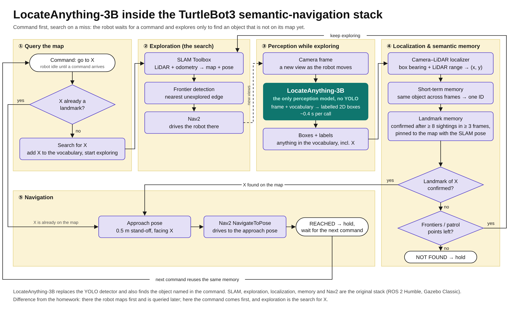
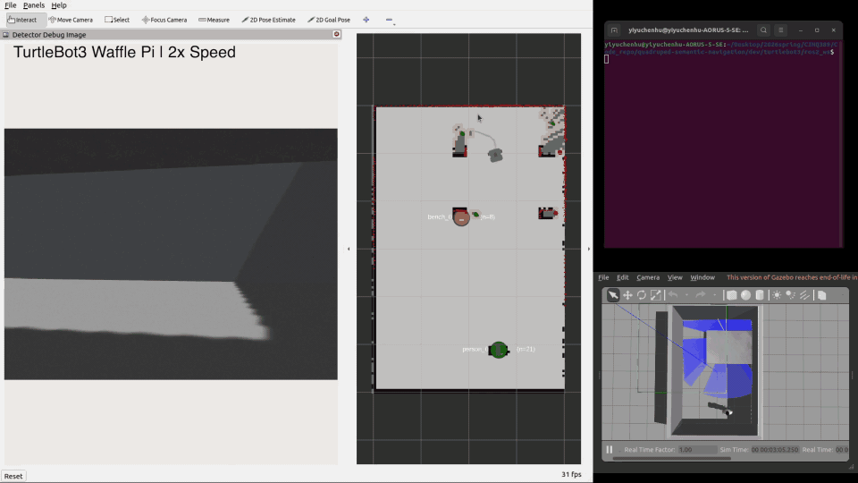

# TurtleBot3 Semantic Navigation (ROS 2)

Standalone extraction of the TurtleBot3 semantic navigation stack: YOLOv8n object detection,
camera–LiDAR object localization, persistent semantic landmarks on a SLAM map, and Nav2 goal
execution driven by simple rule-based text commands (e.g. `go to person`, `go to bench`).

**Stack:** Ubuntu 22.04 · ROS 2 Humble · Gazebo Classic · TurtleBot3 `waffle_pi` · YOLOv8n · Nav2 · SLAM Toolbox launched through `nav2_bringup` with `slam:=True`.

> **LocateAnything version:** the [`feat/locateanything`](https://github.com/YiyuchenHu/TurtleBot3-semantic-navigation/tree/feat/locateanything) branch replaces
> YOLOv8n with NVIDIA LocateAnything-3B (open-vocabulary detection served from a GPU container) and adds
> command-first search: the robot waits for a command and explores only to find an object that is not on its
> map yet. This `main` branch keeps the original YOLOv8n stack described below.

## Project Highlights

- **End-to-end semantic navigation pipeline on TurtleBot3 Waffle Pi**, from perception and SLAM through semantic memory to Nav2 goal execution, brought up by a single `ros2 launch` entry point.
- **YOLOv8n integrated into ROS 2** as a detector node that consumes `sensor_msgs/Image`, publishes standard `vision_msgs/Detection2DArray`, and exposes an annotated debug image for RViz.
- **Camera–LiDAR object localization** that converts each YOLO bounding-box centre into a bearing through the camera FOV and looks up a robust median range from a small `LaserScan` window to produce per-object `(x, y)` positions.
- **Semantic memory with deterministic per-class IDs** such as `person_0`, `person_1`, …, label-aware nearest-neighbour association, EMA position smoothing, and stale/remove aging, so repeated observations of the same physical object collapse into a single addressable landmark.
- **Persistent semantic landmarks on the SLAM map**, validated against the live occupancy grid (wall-island rejection, snap to obstacle-island centroid) and republished as `MarkerArray` overlays in RViz.
- **Rule-based natural-language-style terminal commands** (`go to person`, `go to person 3`, `please navigate to the bench`, …) handled deterministically with **no LLM**, supporting nearest-target and indexed selection over semantic memory.
- **Coordinator state machine** that pauses frontier exploration on a user command, dispatches the goal through Nav2's `NavigateToPose` action with cancellation and timeouts, and auto-resumes exploration when the target is reached or aborted.

## LocateAnything Mode (Open-Vocabulary Perception)



*A user command first queries semantic memory; if the target is unknown, the robot explores with LocateAnything-3B, localizes and confirms the landmark, approaches it with Nav2, and then holds for the next command.*

The `feat/locateanything` work replaces YOLOv8n with **NVIDIA LocateAnything-3B**
as the only perception model in the running stack: detection happens over HTTP
(`POST /detect`) in a GPU grounding container (`grounding/` + `docker/`), the
detect vocabulary is free-form text instead of COCO classes, and a **search
link** lets the robot find objects that are *not* in the current vocabulary —
`go to the trash can` with a person-only vocabulary injects the phrase into the
detector via `/active_search`, explores until the landmark is promoted, then
navigates to it. Unknown objects (`go to the bicycle`) end in an explicit
`TARGET NOT FOUND` after exploration completes, with no ghost landmarks.

Entry point (both containers up, then inside the sim container):

```bash
docker compose -f docker/compose.yaml -f docker/compose.local.yaml up -d
ros2 launch tb3_coordinator full_semantic_nav_la.launch.py
```

The step-by-step terminal/recording procedure, vocabulary profiles
(4-class default vs. person-only search-demo), verified spawn points, and
known pitfalls live in **[docs/la_runbook.md](docs/la_runbook.md)**.

The YOLOv8n path below is kept intact as the **baseline**: the detector node
stays in the repo and `full_semantic_nav.launch.py` still runs it; the two
launches share every node except the detection producer.

## Demo Videos

### Demo 1 — Bench/Person Semantic Navigation

This demo shows TurtleBot3 Waffle Pi exploring an initially unknown 4×6 warehouse and building a SLAM map from scratch. YOLOv8n detects a table/bench target and a person; the camera–LiDAR localizer places them as semantic landmarks on the SLAM map, and a rule-based terminal command navigates the robot to the selected target through Nav2.

The full demo video is shown at 2x speed.

**Detection and semantic mapping**


**Command-based navigation**



Full demo: [Google Drive](https://drive.google.com/file/d/1D3oExylmRMmw4Q7x_d1_mcE8EcazT35I/view?usp=sharing)

---

### Demo 2 — Multi-Person Semantic Navigation with Memory Indexing

This demo shows TurtleBot3 Waffle Pi exploring an initially unknown 6×6 warehouse, building a SLAM map from scratch, detecting five identical person models with YOLOv8n, storing them as memory-indexed semantic landmarks (`person_0`, `person_1`, …), and navigating to a selected instance through a rule-based terminal command.

The full demo video is shown at 4x speed.

**Note:** Person IDs such as `person_3` are memory indices assigned by detection order, not human identity recognition.

**Multi-person semantic mapping**


**Command-based navigation**


Full demo: [Google Drive](https://drive.google.com/file/d/1Qzl15Erv7ww3lYTszrFD-1H1IQfuDk9D/view?usp=sharing)

## System Pipeline

```text
   ┌──────────────────────────────────────────────────────────┐
   │   Gazebo Classic + TurtleBot3 Waffle Pi simulation       │
   │   (custom 4×6 / 6×6 warehouse worlds)                    │
   └──────────┬─────────────────────────────────┬─────────────┘
              │ /camera/image_raw               │ /scan
              ▼                                 │
   ┌──────────────────────────┐                 │
   │  tb3_detector            │                 │
   │  YOLOv8n inference       │                 │
   │  → Detection2DArray      │                 │
   │  + ~/debug_image (RViz)  │                 │
   └──────────┬───────────────┘                 │
              │                                 │
              ▼                                 ▼
   ┌─────────────────────────────────────────────────────────┐
   │  tb3_localizer                                          │
   │  pixel → camera-FOV bearing                             │
   │  + windowed median LiDAR range → (x, y) in base_link    │
   └──────────┬──────────────────────────────────────────────┘
              │
              ▼
   ┌─────────────────────────────────────────────────────────┐
   │  tb3_memory / semantic_memory_node                      │
   │  label-aware nearest-neighbour association,             │
   │  EMA position smoothing, stale/remove aging             │
   │  → object_id = "<label>_<seq>"                          │
   └──────────┬──────────────────────────────────────────────┘
              │ ~/objects                ┌────────────────────────┐
              ├─────────────────────────►│  SLAM Toolbox          │
              │                          │  (via nav2_bringup,    │
              │                          │   slam:=True) → /map   │
              ▼                          └──────────┬─────────────┘
   ┌─────────────────────────────────────────────┐ │
   │  tb3_coordinator/semantic_map_memory_node   │◄┘  /map
   │  TF base_link→map, occupancy-grid           │
   │  validation, persistent semantic landmarks  │
   │  → MarkerArray on the SLAM map              │
   └─────────────────────────────────────────────┘

   terminal command
   "go to person 3"  /  "please navigate to the bench"
              │  /user_command
              ▼
   ┌─────────────────────────────────────────────┐
   │  tb3_coordinator (state machine)            │
   │  pauses frontier exploration, cancels any   │
   │  prior Nav2 goal, forwards the command      │
   └──────────┬──────────────────────────────────┘
              ▼
   ┌─────────────────────────────────────────────┐
   │  tb3_query (rule-based, no LLM)             │
   │  filler-word stripping, phrase aliases,     │
   │  index/nearest selection over memory        │
   │  → SemanticQueryResult                      │
   └──────────┬──────────────────────────────────┘
              ▼
   ┌─────────────────────────────────────────────┐
   │  tb3_nav_adapter                            │
   │  computes safe standoff approach pose,      │
   │  TF base_link → map → PoseStamped           │
   └──────────┬──────────────────────────────────┘
              ▼
   ┌─────────────────────────────────────────────┐
   │  Nav2 NavigateToPose action                 │
   │  global+local planner, controller,          │
   │  recoveries on the SLAM map                 │
   └──────────┬──────────────────────────────────┘
              ▼
        TurtleBot3 drives to the
        selected semantic landmark
```

The simulated TurtleBot3 streams a forward RGB image and a 360° LiDAR scan into ROS 2. `tb3_detector` runs YOLOv8n on every frame and publishes 2D detections, while `tb3_localizer` converts each bounding-box centre into a camera-frame bearing and looks up a robust median range from a small LiDAR window to obtain an `(x, y)` position in `base_link`. `tb3_memory` merges those observations into stable semantic landmarks with deterministic per-class IDs such as `person_0`, `person_1`, …, and `semantic_map_memory_node` snaps them onto the live SLAM Toolbox map for RViz overlay. A terminal command on `/user_command` is intercepted by the coordinator, parsed by the **deterministic, rule-based** `tb3_query` node (no LLM), turned into a safe approach pose by `tb3_nav_adapter`, and executed by Nav2's `NavigateToPose` action — after which the coordinator resumes frontier exploration. These IDs (e.g. `person_3`) are semantic-memory slots, not identity recognition; the system does not perform person re-identification.

## Quick build (YOLO baseline)

> This section covers the original YOLOv8n baseline path. For the
> LocateAnything mode, see [docs/la_runbook.md](docs/la_runbook.md).

> **Before building: download YOLOv8n weights (~6 MB).**
> The `*.pt` files are git-ignored (see `src/tb3_detector/models/.gitignore`),
> so you must fetch them locally **before `./build.sh`** — otherwise
> `detector_node` crashes on startup with `FileNotFoundError: yolov8n.pt`
> and the **"Detector Debug Image"** panel in RViz stays blank ("No Image").
>
> ```bash
> cd ~/TurtleBot3-semantic-navigation
> wget -O src/tb3_detector/models/yolov8n.pt \
>   https://github.com/ultralytics/assets/releases/download/v8.2.0/yolov8n.pt
> ```

### One-click start

```bash
cd ~/TurtleBot3-semantic-navigation
./build.sh
source /opt/ros/humble/setup.bash
source install/setup.bash
export TURTLEBOT3_MODEL=waffle_pi
ros2 launch tb3_coordinator full_semantic_nav.launch.py
```

Runtime debug overlay:

```bash
ros2 launch tb3_coordinator full_semantic_nav.launch.py use_runtime_debug:=true
```

### Choose a Gazebo world

The launch ships with **2 built-in worlds** under
`src/tb3_frontier_exploration/worlds/`. Pick one with `world:=<alias>` —
the matching default spawn pose is applied automatically:

| Alias                      | World file                          | Size      | Contents                                                                                              | Auto spawn       |
| -------------------------- | ----------------------------------- | --------- | ----------------------------------------------------------------------------------------------------- | ---------------- |
| `warehouse_models_person`  | `warehouse_models_person.world`     | 6 × 6 m   | **Default.** 5 `person` figures at the four corners + centre. Tuned for the "go to person N" workflow. | `(-1.5,  0.0)`   |
| `warehouse_models`         | `warehouse_semantic_models.world`   | 4 × 6 m   | One `table` (semantic alias `bench`) + one `person`. The original single-target test world.            | `(-1.2, -1.2)`   |

```bash
# Default — five-person room, spawn pose set automatically to (-1.5, 0)
ros2 launch tb3_coordinator full_semantic_nav.launch.py

# The original single-target world
ros2 launch tb3_coordinator full_semantic_nav.launch.py \
  world:=warehouse_models

# Override the spawn manually if you want
ros2 launch tb3_coordinator full_semantic_nav.launch.py \
  world:=warehouse_models_person x_pose:=0.0 y_pose:=-2.0

# Custom .world file (absolute path also accepted; spawn defaults to (-1.2, -1.2))
ros2 launch tb3_coordinator full_semantic_nav.launch.py \
  world:=/path/to/my_custom.world x_pose:=0.0 y_pose:=0.0
```

Bad aliases / missing files are caught at launch time:

```text
FileNotFoundError: [full_semantic_nav] world='foo' could not be resolved.
Tried as alias: .../worlds/foo.
Pass one of the built-in aliases (warehouse_models, warehouse_models_person)
or an absolute path to a .world file.
```

> **Why a 6 × 6 room for `warehouse_models_person`?** TurtleBot3's LDS-01
> LiDAR has a max range of 3.5 m. Sizing the room so the centre is exactly
> 3 m from every wall guarantees scan-matching always sees ≥ 3 walls plus
> visible corners — eliminating the "infinite corridor" ambiguity (and the
> resulting broken occupancy patches) that plagued the earlier 6 × 10 m
> layout.

### Send semantic commands (second terminal, same workspace sourced)

The command interface accepts natural-language-*style* phrases, but the parser is **deterministic and rule-based — there is no LLM**. `parse_command` in [`src/tb3_query/tb3_query/query_core.py`](src/tb3_query/tb3_query/query_core.py) lowercases the input, strips punctuation, drops a fixed **filler** word list (`go`, `to`, `the`, `please`, `navigate`, …), and then resolves the remaining tokens against the **canonical targets** loaded from `semantic_targets.yaml` (only entries with `enabled: true`). Extra words are ignored unless they appear before a recognized target token.

**Currently enabled semantic names:** `table`, `person` (see `src/tb3_frontier_exploration/config/semantic_targets.yaml`). Phrase alias `bench → table` is applied at parse time, so commands containing `bench` resolve to the `table` landmark.

**Selection policy:**

- `go to person`  → the **nearest** observed person (no number means nearest).
- `go to person N` → the specific instance with `object_id == person_N` in semantic memory. Memory assigns ids `person_0, person_1, …` in **observation order** (per [`tb3_memory/memory_core.py`](src/tb3_memory/tb3_memory/memory_core.py)), so `person_N` is a memory slot — it is **not** an identity-recognised person, and the same physical figure may end up as a different `person_N` across runs depending on the path the robot took. Inspect with `ros2 topic echo /semantic_memory_node/objects` to see the live mapping.
- Recognised number forms: `person 3`, `person_3`, `person3`, `person number 3`, `person no 5`.
- Same rules apply to `table` (in worlds where multiple tables exist).

Examples in the **default world** `warehouse_models_person` (5 persons):

```bash
# Closest person (no number)
ros2 topic pub --once /user_command std_msgs/String "data: 'go to person'"
```

```bash
# Memory slot "person_3" (the 4th observation, 0-indexed; not an identity — see selection policy)
ros2 topic pub --once /user_command std_msgs/String "data: 'go to person 3'"
```

```bash
# Underscore form
ros2 topic pub --once /user_command std_msgs/String "data: 'navigate to person_2'"
```

```bash
# Glued form (no separator)
ros2 topic pub --once /user_command std_msgs/String "data: 'go to person0'"
```

```bash
# "number" / "no" filler is allowed
ros2 topic pub --once /user_command std_msgs/String "data: 'find person number 4'"
```

Examples in the smaller `warehouse_models` world (1 table + 1 person):

```bash
ros2 topic pub --once /user_command std_msgs/String "data: 'go to person'"
```

```bash
ros2 topic pub --once /user_command std_msgs/String "data: 'please could you navigate to the table'"
```

```bash
ros2 topic pub --once /user_command std_msgs/String "data: 'I need you to approach the bench'"
```

```bash
ros2 topic pub --once /user_command std_msgs/String "data: 'find a person for me'"
```

## Packages

`tb3_detector` · `tb3_localizer` · `tb3_memory` · `tb3_coordinator` (+ `semantic_map_memory_node`) · `tb3_query` · `tb3_nav_adapter` · `tb3_frontier_exploration`.

Persistent semantic landmarks rendered on the SLAM map come from
[`tb3_coordinator/semantic_map_memory_node`](src/tb3_coordinator/tb3_coordinator/semantic_map_memory_node.py),
which TFs each `tb3_memory` observation into the `map` frame, validates it
against the live occupancy grid, and republishes confirmed landmarks as a
`MarkerArray` for RViz.

Canonical semantic name mapping lives in
`src/tb3_frontier_exploration/config/semantic_targets.yaml`.

The YOLOv8n weights are expected at
`src/tb3_detector/models/yolov8n.pt`. They are **not committed** to the
repository (see `src/tb3_detector/models/.gitignore`); download them
locally before the first build by following the [Quick build](#quick-build)
section.

## My Contributions

This project uses standard, well-known robotics components — ROS 2 Humble, Gazebo Classic, TurtleBot3, SLAM Toolbox, Nav2, and the Ultralytics YOLOv8n model. My contribution is the design and implementation of the integration layer that turns those components into a single working TurtleBot3 semantic-navigation pipeline.

Specifically, I:

- **Designed and implemented the end-to-end ROS 2 semantic navigation pipeline**, from perception and SLAM through semantic memory to Nav2 goal execution, brought up by a single launch file.
- **Organized the system into seven focused ROS 2 packages** with clean topic and message contracts: `tb3_detector`, `tb3_localizer`, `tb3_memory`, `tb3_query`, `tb3_nav_adapter`, `tb3_coordinator`, and `tb3_frontier_exploration`.
- **Integrated YOLOv8n with ROS 2** through a wrapper node that consumes `sensor_msgs/Image`, runs Ultralytics inference with configurable confidence and class filters, and publishes standard `vision_msgs/Detection2DArray` plus an annotated debug image for RViz.
- **Implemented camera–LiDAR object localization**: pixel-to-bearing conversion through the camera HFOV, robust windowed `LaserScan` range estimation, and planar projection to `(x, y)` in `base_link`, with TF transformation to the SLAM `map` frame.
- **Built the semantic memory and semantic-landmark behaviour** — label-aware nearest-neighbour association, EMA position smoothing, deterministic per-class IDs such as `person_0`, `person_1`, …, stale/remove aging, and occupancy-grid-validated landmark promotion rendered as a `MarkerArray` on the SLAM map.
- **Implemented deterministic, natural-language-style terminal commands without an LLM**: filler-word stripping, multi-word phrase aliases (e.g. `bench → table`), several index forms (`person 3`, `person_3`, `person3`, `person number 3`), and nearest-vs-indexed selection policies over semantic memory.
- **Connected semantic target selection to Nav2** through a goal adapter that computes a safe standoff approach pose and a coordinator state machine (`EXPLORING → SEMANTIC_QUERYING → SEMANTIC_NAV → TARGET_REACHED/FAILED`) that drives `NavigateToPose` with cancellation, timeouts, and auto-resume of frontier exploration.
- **Designed the Gazebo test worlds** (4×6 single-bench/person and 6×6 five-person scenarios) and **recorded the demo videos and GIF previews** used in this README.
- **Debugged, tested, documented, and validated the system in simulation**, and wrote the user-facing setup, command, and troubleshooting documentation.

The underlying detection model, SLAM stack, navigation stack, simulator, and robot platform are not my own work; my work is the architecture, ROS 2 integration, perception-to-navigation glue, semantic memory behavior, test worlds, documentation, and demonstrations that make them function together as a semantic-navigation system.

## Development History

This repository is a cleaned standalone version of my TurtleBot3 semantic navigation work. It is intended to make the system easier to review, reproduce, and demonstrate.

Earlier development workspace:

- <https://github.com/YiyuchenHu/quadruped-semantic-navigation>

The earlier workspace contains broader experiments and development history across a larger robotics project. This repository keeps the TurtleBot3 semantic navigation stack organized as a focused demonstration and reproducible project.
