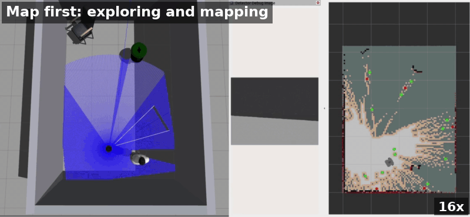
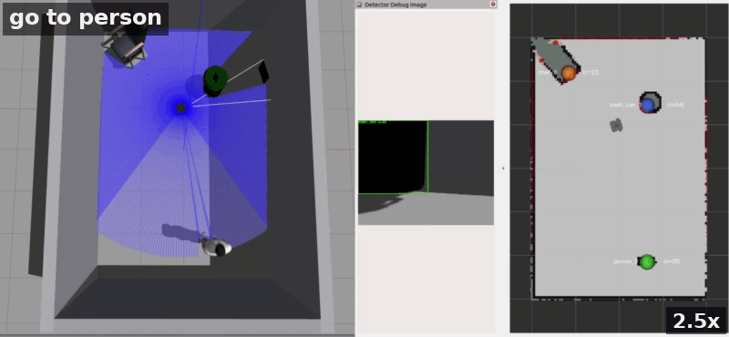

# TurtleBot3 Semantic Navigation — fine-tuned YOLO26n variant

A TurtleBot3 in Gazebo explores an unknown room on its own, builds a SLAM map,
recognises the objects it passes and remembers where they are. A text command
such as `go to chair` then stops exploration and drives the robot to that
object with Nav2.

Perception is a **YOLO26n detector fine-tuned on data collected in this
simulation** (three classes: `person`, `trash_can`, `chair`; labels come from
Gazebo ground truth). Fine-tuning was needed because COCO-pretrained YOLO
is unreliable on these Gazebo models: it reports the trash can as a
`traffic light`, and it misses the chair from some viewing angles. On a held-out
test set rendered in the same simulator, fine-tuning raised AP50 for
`trash_can` from 0.35 (COCO weights, with `traffic light` counted as a trash
can) to 0.995 and for `chair` from 0.73 to 0.995; the network and its CPU cost
are unchanged. It runs on a **CPU** (about 32 ms per 640×480 frame on a
laptop i7), so no GPU is needed, and the stack runs on **Ubuntu 22.04
natively, on macOS through Docker, and on Windows through WSL 2**.

**Map first:** the robot explores and promotes landmarks (16× speed).



**Then query:** `go to person`, `go to trash can`, `go to chair` (2.5× speed).



## How this branch differs from `main`

| | this branch (`yolo26n-finetuned`) | [`main`](https://github.com/YiyuchenHu/TurtleBot3-semantic-navigation/tree/main) |
|---|---|---|
| Order | **map first, query later**: explore the whole room, then send commands | **command first**: the command starts a search, exploration is the search |
| Vocabulary | **fixed, 3 classes** (`person`, `trash_can`, `chair`) | free text, via NVIDIA LocateAnything-3B |
| Hardware | CPU only; Ubuntu, macOS (Docker), Windows (WSL 2) | Linux + NVIDIA GPU (≥ 14 GB VRAM) |

The 2026-04 YOLOv8n version this project started from is on the
[`yolov8n-baseline`](https://github.com/YiyuchenHu/TurtleBot3-semantic-navigation/tree/yolov8n-baseline)
branch.

This version served as the reference implementation for a Lehigh University
robotics course assignment; the student version is at
<https://github.com/YiyuchenHu/turtlebot3-gazebo-navigation-hw>.
`scripts/acceptance_run.sh` runs the whole stack unattended and passes when
`go to person 0`, `go to trash can` and `go to chair` each end with the robot
within 1.2 m of the real object.

## Repository layout

| Package (`src/`) | Role |
|---|---|
| `tb3_detector` | YOLO detection on the camera image (`tb3det_yolo26n`, fine-tuned; weights included) |
| `tb3_bringup` | every launch file, the RViz config, the Gazebo worlds, the vendored models and `semantic_targets.yaml` |
| `tb3_localizer` | bbox centre → bearing + LiDAR range → `(x, y)` in `base_link` |
| `tb3_memory` | short-term memory, stable IDs `person_0…` |
| `tb3_coordinator` | persistent map landmarks + the coordinator state machine |
| `tb3_query` | rule-based command parsing (`SemanticQueryResult` msg) |
| `tb3_nav_adapter` | approach-pose computation for Nav2 |
| `tb3_frontier_exploration` | frontier detection + goal assignment (C++) |

Outside `src/`: [`docker/`](docker/) is the image behind the macOS and Windows
setups, [`docs/`](docs/) the setup pages and demo media, [`scripts/`](scripts/)
the end-to-end acceptance run.

```text
camera ─► tb3_detector ─┐
                        ├─► tb3_localizer ─► tb3_memory ─► semantic_map_memory
LiDAR ──────────────────┘   (boxes → x,y)    (stable IDs)  (landmarks on the map)
                                                                    │
"go to person 2" ─► tb3_query ─► tb3_nav_adapter ─► tb3_coordinator + Nav2
                    (parse)      (approach pose)   (pauses exploring, drives)
```

## Setup by platform

| Platform | Start here | What you get |
|---|---|---|
| **Ubuntu 22.04** *(default — the validated setup)* | the steps just below | native ROS 2 Humble + Gazebo Classic 11 |
| **macOS** (Apple Silicon or Intel) | [docs/setup-macos.md](docs/setup-macos.md) | a Docker container with this checkout mounted, Gazebo/RViz in a browser tab, then the steps below |
| **Windows 10/11** | [docs/setup-windows.md](docs/setup-windows.md) | WSL 2 + Ubuntu 22.04 running the same native stack, then the steps below (Docker is a documented fallback) |

You need Ubuntu 22.04 with ROS 2 Humble and Gazebo Classic 11, 4+ CPU cores,
and `tmux` (for `scripts/acceptance_run.sh` only).

**0. Get the code** (into your home directory; the steps below assume
`~/TurtleBot3-semantic-navigation`):

```bash
cd ~
git clone -b yolo26n-finetuned https://github.com/YiyuchenHu/TurtleBot3-semantic-navigation.git
```

**1. apt packages.** If ROS 2 Humble is not installed yet, first add its apt
repository as in the
[ROS 2 Humble install guide](https://docs.ros.org/en/humble/Installation/Ubuntu-Install-Debs.html).

```bash
sudo apt install \
  ros-humble-desktop \
  ros-humble-gazebo-ros-pkgs \
  ros-humble-turtlebot3-gazebo \
  ros-humble-navigation2 ros-humble-nav2-bringup \
  ros-humble-slam-toolbox \
  ros-humble-vision-msgs ros-humble-cv-bridge \
  ros-humble-tf2-geometry-msgs \
  ros-humble-rqt-image-view \
  python3-colcon-common-extensions \
  python3-pip \
  tmux
```

**2. pip packages.** Order and pins matter: `ultralytics` pulls in `torch` and
would fetch the ~2 GB CUDA build, so install the CPU build first; `numpy` stays
below 2.0 because Humble's `cv_bridge` is built against NumPy 1.x.

```bash
pip install torch==2.5.1 torchvision==0.20.1 --index-url https://download.pytorch.org/whl/cpu
pip install 'numpy==1.26.4' 'opencv-python==4.9.0.80' 'ultralytics==8.4.31'
```

**3. Detector weights** — nothing to do. `tb3det_yolo26n.pt` (5.4 MB) ships
with the repository and is picked up by the build.

**4. Build.** If you have conda, run `conda deactivate` first.

```bash
cd ~/TurtleBot3-semantic-navigation
source /opt/ros/humble/setup.bash
colcon build --symlink-install
```

Keep `--symlink-install` on **every** build — dropping it later makes edits to
configs and launch files silently stop taking effect.

## Running

In **every** terminal, prepare the environment first:

```bash
cd ~/TurtleBot3-semantic-navigation
source /opt/ros/humble/setup.bash
source install/setup.bash
export TURTLEBOT3_MODEL=waffle_pi
```

Then open the terminals **in order**, waiting for each ready signal before
starting the next:

| # | Command | What it starts | Ready when … |
|---|---|---|---|
| T1 | `ros2 launch tb3_bringup sim.launch.py` | Gazebo (server + GUI) + TurtleBot3 spawn, vendored `GAZEBO_MODEL_PATH` | Console prints `Successfully spawned entity [waffle_pi]` and the Gazebo window shows the room + robot (~5 s; first-ever start can take longer) |
| T2 | `ros2 launch tb3_bringup nav.launch.py` | SLAM Toolbox + Nav2 + RViz | Console prints `[lifecycle_manager_navigation]: Managed nodes are active` (~5–10 s); RViz shows a first gray map patch |
| T3 | `ros2 launch tb3_bringup backend.launch.py` | Backend: memory, semantic map memory, query, nav adapter, coordinator, warmup + frontier exploration | `CoordinatorNode ready — mode=EXPLORING` immediately; after a ±45° warm-up scan, `frontier exploration enabled` (~10 s) and the robot starts exploring |
| T4 | `ros2 launch tb3_bringup localizer.launch.py` | Localizer (bbox + LiDAR → object position) | `LocalizerNode ready` + `Image width learned: 640 px` (~1 s), then quiet until detections arrive |
| T5 | `ros2 launch tb3_bringup detector.launch.py` | Detector: YOLO inference on the camera image | `Model loaded. Classes: [...]` then `detector_node ready` (~3 s, first inference warms up torch); `ros2 topic echo /detector_node/detections` streams non-empty `detections` once an object is in view; RViz **Detector Debug Image** shows green boxes |
| T6 | *(no launch — the command console)* | Send user commands, watch status | — |

```bash
# T6
ros2 topic pub --once /user_command std_msgs/String "data: 'go to person 0'"
ros2 topic echo /coordinator_node/status
```

**Exploration takes 2–8 minutes.** Only objects the robot has actually seen can
be navigated to, so a `go to …` sent too early fails with
`no active <target> in memory`. Watch `/semantic_memory_markers` in RViz and
send commands once the landmarks you want have appeared. You can restart any
single terminal without touching the others.

## More

- **Something is broken** → [docs/troubleshooting.md](docs/troubleshooting.md)
  (clean restart, the Nav2 spin-in-place wedge, chair/trash-can mix-ups).
- **Build details, other worlds, the one-command launch, and where to change
  things** → [docs/running-reference.md](docs/running-reference.md).

## License

The code, launch files, worlds and documentation in this repository are
MIT-licensed (see [LICENSE](LICENSE)).

The fine-tuned detector weights, `src/tb3_detector/models/tb3det_yolo26n.pt`,
are derived from the Ultralytics YOLO26n pretrained weights and are therefore
subject to the [AGPL-3.0](https://github.com/ultralytics/ultralytics/blob/main/LICENSE),
not MIT. The `ultralytics` package they run on is AGPL-3.0 as well.

The vendored Gazebo models are third-party content — see [NOTICE](NOTICE) for
their provenance and licensing status.
